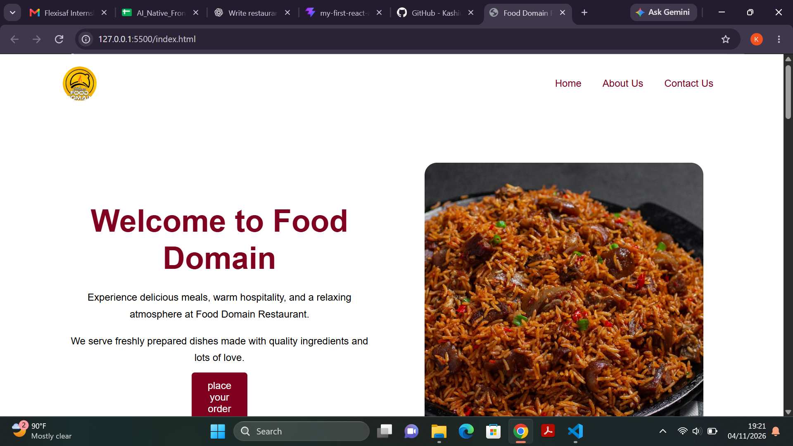

# Restaurant Website

A responsive restaurant website built with HTML and CSS.

# Pages
- Home
- About
- Contact

# Technologies Used
- HTML
- CSS
- Flexbox
- Media Queries

# How to Run the Project

1. Download or clone this repository.
2. Open the project folder in VS Code.
3. Open `index.html` in your browser.

# Screenshot

# Flexbox and CSS Grid

I used Flexbox to arrange elements along one direction, such as the navigation links.

I used CSS Grid to arrange elements into rows and columns, such as the gallery section.
